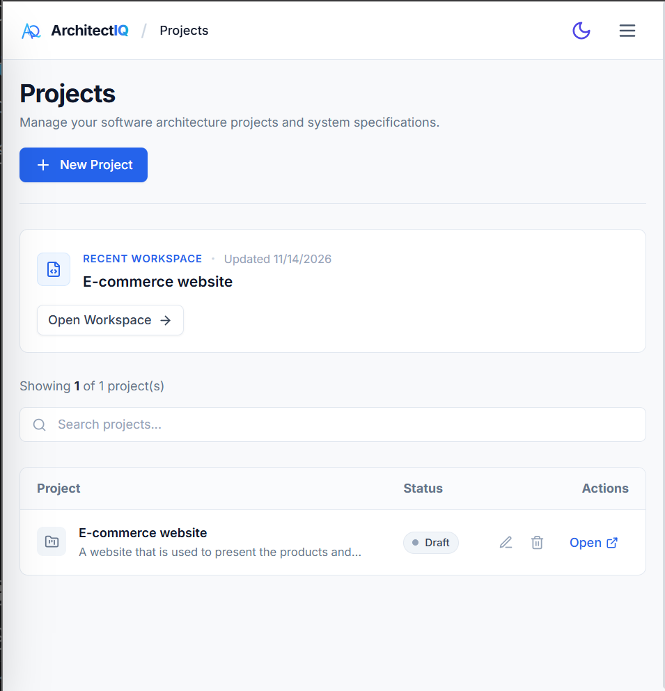
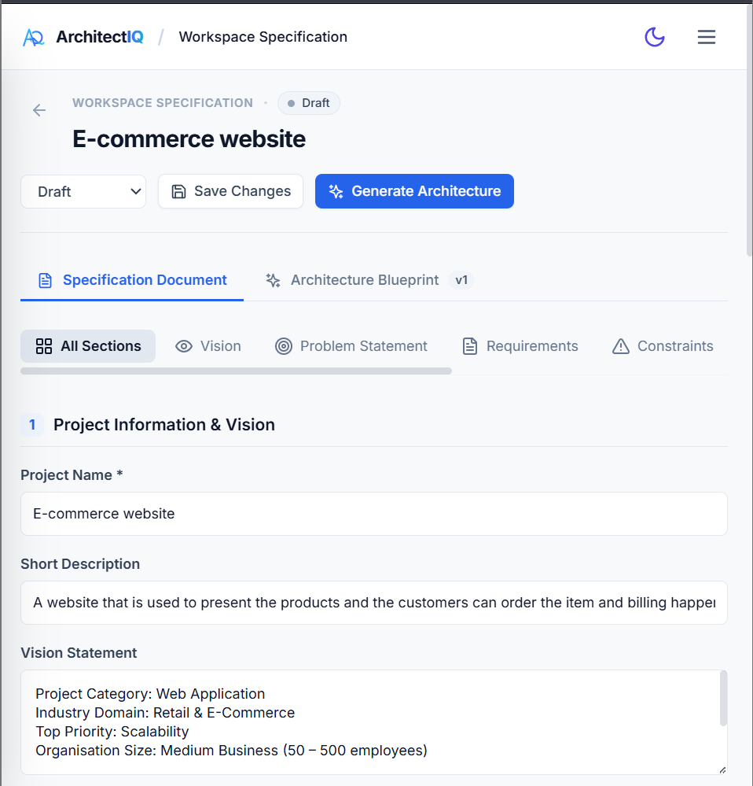
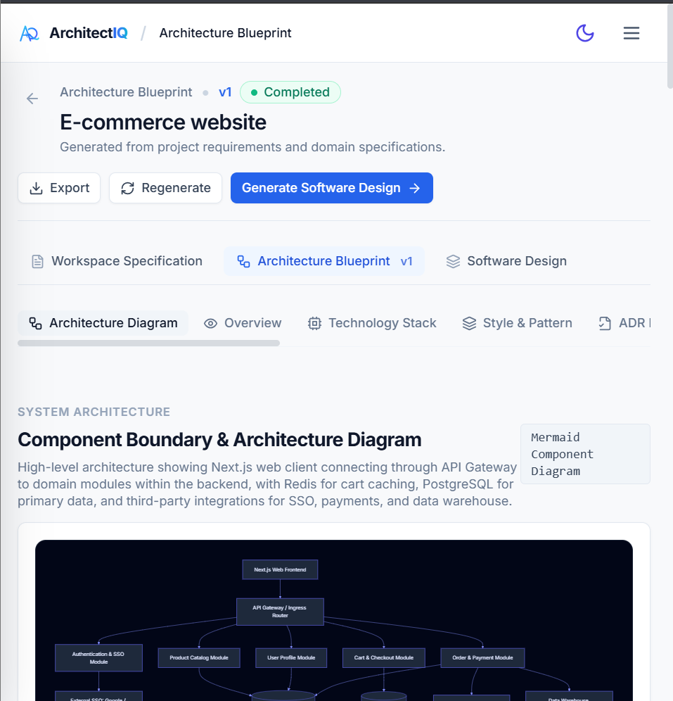
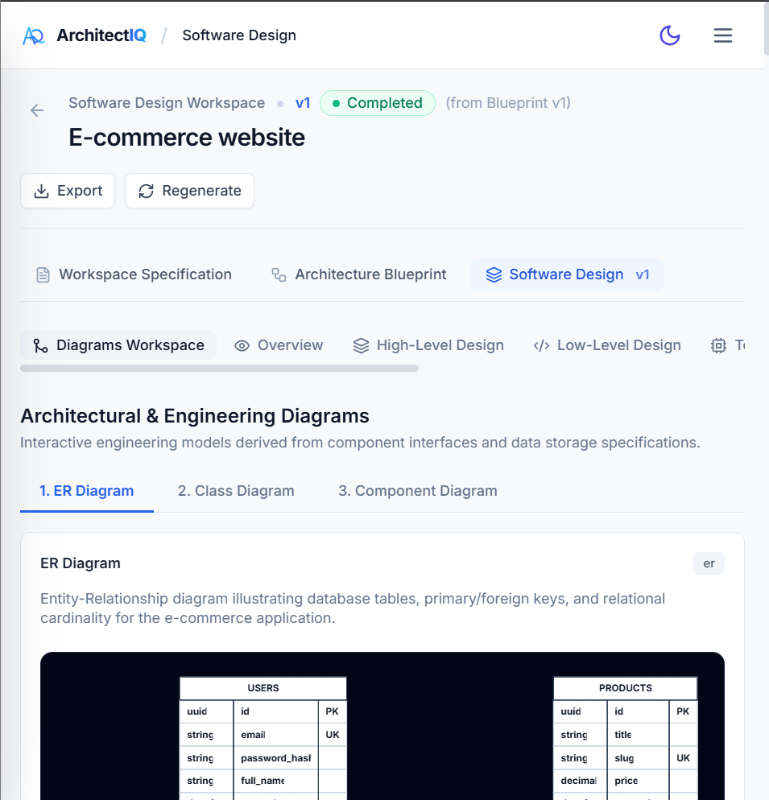
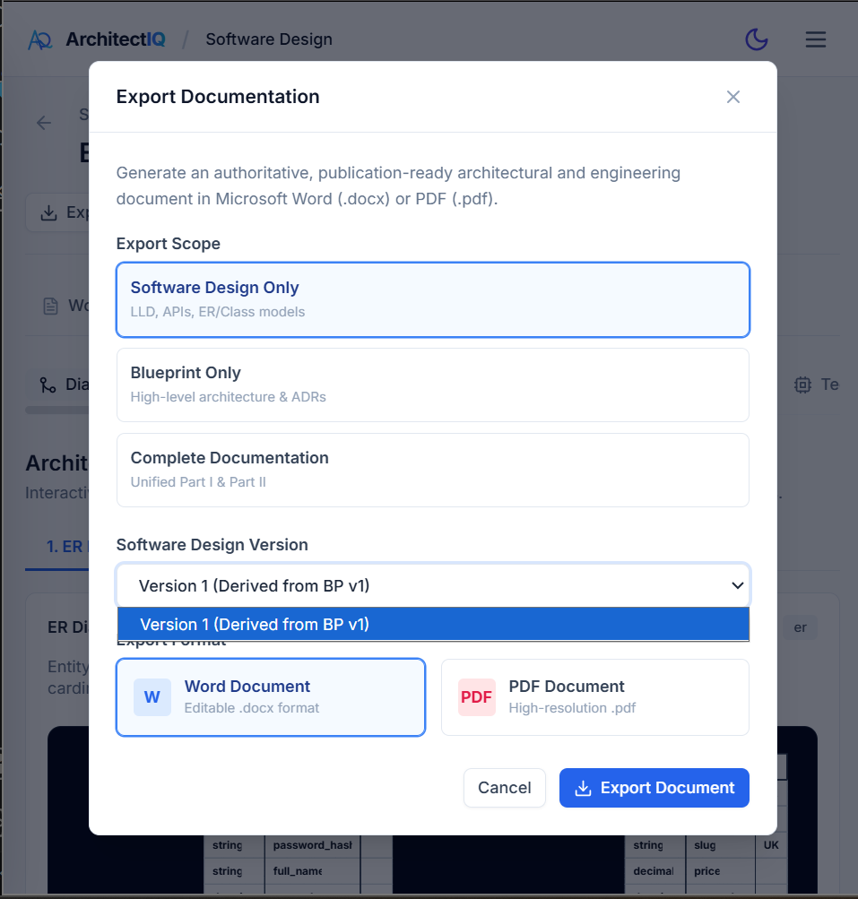

# ArchitectIQ

### AI-Powered Software Planning and Architecture Workspace

ArchitectIQ is an AI-powered platform that helps developers transform project ideas into structured software plans and architecture designs.

Users can create projects, complete guided questionnaires, generate AI-powered architecture blueprints and software designs, visualize system diagrams, and export documentation in PDF and DOCX formats.

**Live Demo:** [ArchitectIQ](https://architectiq-gamma.vercel.app)

## ✨ Key Features

- **Project Workspace:** Create and manage software projects in one place.
- **Guided Questionnaires:** Answer structured questions to define project requirements.
- **AI Architecture Blueprint:** Generate architecture recommendations based on project requirements.
- **Software Design Generation:** Create detailed software design documentation.
- **AI Regeneration:** Regenerate architecture blueprints and software designs when requirements change.
- **Architecture Diagrams:** Visualize system architecture using Mermaid diagrams.
- **Document Export:** Export generated documentation in PDF and DOCX formats.
- **User Authentication:** Secure registration and login functionality.

---

## 🛠️ Technology Stack

### Frontend
- React.js
- TypeScript
- Vite
- Tailwind CSS
- React Router
- Lucide React

### Backend
- Python
- FastAPI
- Pydantic
- SQLAlchemy

### Database
- PostgreSQL
- Alembic (Database Migrations)

### AI Integration
- Google Gemini API

### Visualization & Export
- Mermaid.js
- PDF and DOCX generation

### Tools & Deployment
- Git & GitHub
- Docker & Docker Compose
- Vercel
- Neon PostgreSQL

---

## 🏗️ System Architecture

ArchitectIQ follows a client-server architecture with a React-based frontend, a FastAPI backend, and a PostgreSQL database.

The frontend communicates with the backend through REST APIs. The backend handles authentication, project management, questionnaire processing, AI integration, and document generation.

Google Gemini API is integrated to generate architecture blueprints and software design documentation based on project requirements.

### Application Flow

1. Users register or log in to the application.
2. Users create a new software project.
3. Users complete the guided project questionnaire.
4. The backend processes the requirements and interacts with the Gemini API.
5. The generated architecture blueprint and software design are displayed.
6. Users can visualize diagrams, regenerate designs, and export documents.

---

## 📸 Application Screenshots

### Login Page
[alt text](image.png)

### Dashboard


### Project Workspace


### Architecture Blueprint


### Software Design


### Export Documentation


---

## 📁 Project Structure

```text
ArchitectIQ/
│
├── backend/
│   ├── app/
│   │   ├── api/
│   │   ├── core/
│   │   ├── models/
│   │   ├── schemas/
│   │   ├── services/
│   │   └── main.py
│   │
│   ├── alembic/
│   ├── requirements.txt
│   └── Dockerfile
│
├── frontend/
│   ├── src/
│   │   ├── components/
│   │   ├── pages/
│   │   ├── services/
│   │   └── assets/
│   │
│   ├── package.json
│   └── Dockerfile
│
├── docker-compose.yml
├── vercel.json
└── README.md
```
---

## 🔐 Environment Variables

ArchitectIQ requires environment variables for database connectivity, authentication, and AI integration.

Create a `.env` file using the provided `.env.example` template and configure the following variables:

| Variable | Description |
|---|---|
| `DATABASE_URL` | PostgreSQL database connection URL |
| `JWT_SECRET` | Secret key used for JWT authentication |
| `GEMINI_API_KEY` | Google Gemini API key |
| `COOKIE_SECURE` | Enables secure cookies in production |
| `COOKIE_SAMESITE` | Configures the cookie SameSite policy |

**Important:** Never commit your actual `.env` file or expose API keys, database credentials, or authentication secrets. Use placeholder values in `.env.example`.

---

## 📡 API Documentation

ArchitectIQ provides REST APIs through the FastAPI backend.

When running the backend locally, access:

- **API Documentation (Swagger UI):** `http://localhost:8000/docs`
- **Health Check:** `/api/v1/health`

## ☁️ Deployment

ArchitectIQ is deployed using:

- **Frontend & Backend:** Vercel
- **Database:** Neon PostgreSQL
- **AI Integration:** Google Gemini API

**Live Application:** https://architectiq-gamma.vercel.app

---

## 🔮 Future Enhancements

- Improve architecture recommendations and AI-generated outputs.
- Add support for more architecture diagram types.
- Enhance project collaboration and workspace management.
- Introduce additional export and documentation options.

---

## 👩‍💻 Author

**Vemula Sri Lasya**

- GitHub: [@lasya276](https://github.com/lasya276)

---

## 📄 License

This project is developed for educational and portfolio purposes.